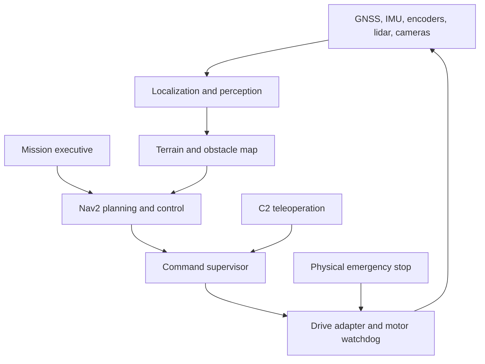

# Rover architecture and implementation boundary

The competition brain runs on the **rover**. Cloud computers build, simulate, analyze logs and train perception. C2 supervises the mission, shows telemetry and provides teleoperation. A failed radio link must not remove the route planner or localization process from the rover.

The diagram is the target architecture. In v0.1, Gazebo replaces the real sensors, drive adapter and chassis. The demo uses simulated wheel odometry, a fixed map origin and 2D lidar; the full localization/perception box is not built.

## Component decisions

| Layer | Initial implementation | Next real-rover implementation |
|---|---|---|
| Mission executive | Python ROS node, validated ordered local goals, explicit start/cancel, arrival confirmation | Route sub-mission and astronaut sub-mission state machines with typed task actions |
| Global route | Nav2 Smac2D on a static prior plus live obstacles | Graded elevation/roughness/keep-out layers; risk-aware route selection |
| Local driving | Nav2 regulated pure pursuit with collision checking | Measure skid/steering dynamics; evaluate MPPI if it improves measured results |
| Localization | Demo odometry, fixed `map→odom` | `robot_localization` local/global filters + `navsat_transform_node`; GNSS, IMU, encoders, lidar/visual odometry as appropriate |
| Perception | Simulated 2D scan and RGB topics | 3D ground/obstacle/negative-obstacle detection, ArUco 4x4_50 pose, person and gesture tracking |
| Safety | Software command gate; freshness, limits, modes and e-stop latch | Independent MCU motor timeout, physical e-stop, inclination/current/thermal protection |
| Communications | ROS topics/services locally; C2 contract defined | Explicit low-bandwidth telemetry/commands gateway, high-bandwidth video/IP gateway |
| Arm/science | Interface boundary only | Separate controllers/action servers with manipulation and sample-handling interlocks |

The terrain importer creates a slope prior. It does not infer friction, soil strength, belly clearance, wheel contact, negative obstacles, or stability. The default 20° slope threshold is a **test assumption**, not a safe slope rating.

## Frame and data contract

Use SI units and ROS ENU/FLU conventions. WGS84 input order is longitude/latitude for GIS APIs. Do not put latitude/longitude directly into `PoseStamped.x/y`.

Real localization should publish `map → odom → base_link → sensor frames`, with one authority per transform. Local EKF publishes continuous `odom→base_link`; a separately configured global filter publishes `map→odom`. Sensor extrinsics must be measured. GNSS antenna lever arm, IMU heading convention, magnetic declination, UTM grid convergence, elevation datum, covariance and timestamp alignment must be resolved before outdoor navigation.

The terrain frame is UTM NAD83 zone 12, translated about the crop center. Grid north is slightly rotated from true north; it is not interchangeable with a raw GNSS local ENU frame. DEM vertical height is normally NAVD88 orthometric, while GNSS may report WGS84 ellipsoid height. Do not fuse these heights without a datum conversion. The flat training world has a reference geographic location for its sensor plugin only; its fictional obstacles are not geolocated Utah obstacles.

## Current ROS interfaces

| Interface | Type | Producer / purpose |
|---|---|---|
| `/scan` | `sensor_msgs/LaserScan` | Gazebo → obstacle layers and freshness checks |
| `/odom` | `nav_msgs/Odometry` | Gazebo wheel odometry → Nav2, supervisor |
| `/imu/data`, `/gps/fix` | `Imu`, `NavSatFix` | Exposed simulator signals; not fused in v0.1 |
| `/camera/image_raw`, `/camera/camera_info` | `Image`, `CameraInfo` | Exposed simulator camera; no detector yet |
| `/navigate_to_pose` | `nav2_msgs/action/NavigateToPose` | Mission → Nav2 |
| `/cmd_vel_nav` | `Twist` | Nav2 → supervisor |
| `/cmd_vel_teleop` | `Twist` | Future C2 adapter → supervisor |
| `/cmd_vel` | `Twist` | Supervisor → simulator drive; sole application writer |
| `/c2/heartbeat` | `std_msgs/Empty` | Teleop liveness; not an authorization credential |
| `/mission/start`, `/mission/cancel` | `std_srvs/Trigger` | Start/cancel this fixed local demo mission |
| `/safety/arm_autonomy`, `/safety/arm_teleop`, `/safety/stop` | `Trigger` | Explicit mode controls |
| `/safety/estop`, `/safety/reset_estop` | `Trigger` | Latch/reset software stop |
| `/rover/status`, `/mission/status`, `/rover/led` | `std_msgs/String` | Prototype telemetry; replace JSON with versioned messages for hardware |

DDS topics are not access controls. Isolate the robot domain and permit only an authenticated, allowlisted C2 gateway on deployment. Do not expose command services or a bidirectional Foxglove bridge publicly. Don't send unrestricted DDS discovery, images or point clouds over the narrowband control radio.

## Failures

- No fresh command: output zero; Nav2 can replan without replaying the last velocity.
- No fresh odometry or scan: HOLD; explicit re-arm is required after recovery.
- Lost C2 heartbeat in TELEOP: HOLD. In AUTONOMY: continue only while local checks pass.
- E-stop: latched. Reset requires fresh sensors and measured zero velocity, and returns to HOLD.
- Mission cancel / rejected goal / failed navigation: request cancellation and stop the command gate. Epoch checks prevent a late action response from resurrecting a canceled goal.
- Supervisor or host crash: the software cannot guarantee a stop. A real motor-controller watchdog and physical stop are mandatory. The Gazebo drive plugin is not proof of that hardware guarantee.
- GNSS jumps, tilt, wheel slip, covariance growth, cliff detection: **not yet monitored**; prerequisites for field trials.
