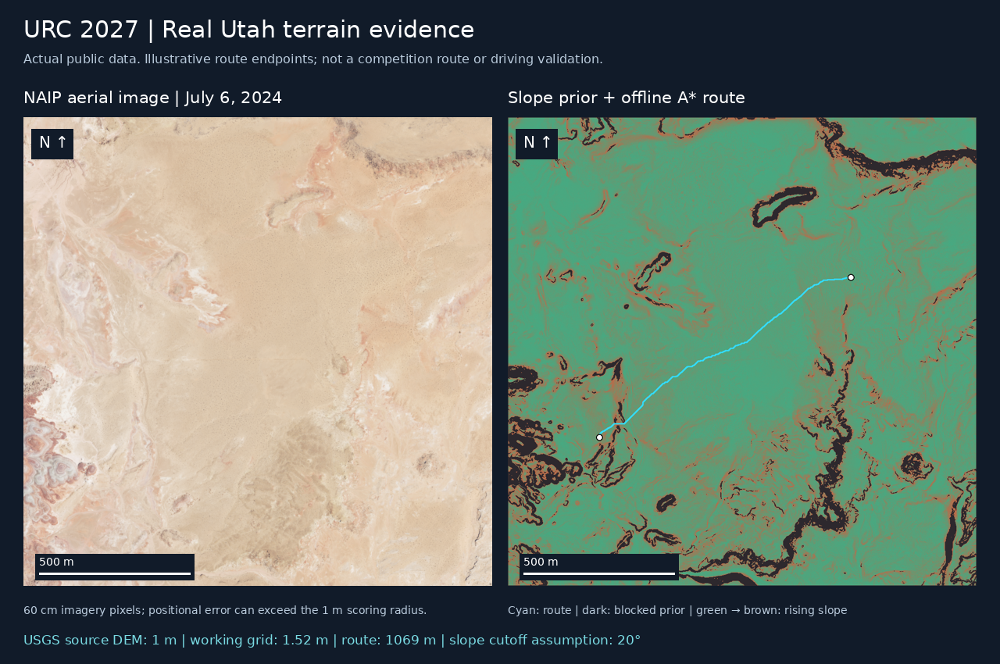

# Source-run evidence — October 20, 2026



This figure uses real source data. Its route is an offline slope-cost experiment with illustrative start/end cells, **not a physics-tested route or a representation of competition target locations**.

A separate, shorter trial on a bundled crop of this terrain subsequently passed actual Gazebo/Nav2 testing on October 21, 2026 UTC. It reached two measured stops and continued through a forced C2-heartbeat outage. See [its verification record](utah-verification.json) and [PC launch instructions](../PRACTICE.md). That result does not validate the long offline route pictured above or the full hill practice course.

## Retrieved data

- USGS 3DEP query returned five candidate 1m tiles intersecting the approximate rule envelope. Not every candidate's valid-data footprint covers it. The successful crop used four contributing 2020/2018 source tiles; the 2022-project candidate had no contributing valid pixels in the crop. Source identities, actual CRS and checksums are retained in `dem-sources.json`.
- Output DEM: **1,576 × 1,558 samples at 1m**, elevations approximately **1,350.95–1,426.43m**. These are data values, not a surveyed accuracy assessment.
- Exported square heightfield: **1,025 × 1,025 samples, 1.52m spacing**. Resampling does not improve source resolution. The 16-bit quantization increment is not an elevation-accuracy claim.
- NAIP source tile `m_3811034_se_12_060_20240706`, acquired **July 6, 2024**, was exported at approximately **0.6m** pixels. Capture and retrieval dates are separate in `naip-source.json`.
- Recent Sentinel-2 discovery included October 18, 2026, but that scene had ~99% scene cloud cover. October 17 had low overall cloud cover yet about 69% of this small AOI was NoData; October 15 also had incomplete coverage. The downloader selected **October 8, 2026** from the ten recent candidates after both scene-cloud and AOI checks, at native 10m RGB resolution. `sentinel2-source.json` records rejected candidates. This is the most recent acceptable item in this queried collection/window, not a claim about every satellite provider.

## Offline route experiment

```bash
python3 tools/terrain.py catalog --output data/catalog.json
python3 tools/terrain.py fetch-dem --catalog data/catalog.json
python3 tools/terrain.py fetch-imagery --catalog data/catalog.json
python3 tools/terrain.py fetch-satellite --catalog data/catalog.json
python3 tools/terrain.py export --dem data/raw/urc_dem.tif
python3 tools/route_preview.py --start 700 200 --goal 350 750 --output artifacts/utah-route
python3 tools/evidence_figure.py
```

At this source snapshot, the example route is **1,069m** long; its largest sampled slope prior is **18.62°** under a **20° assumed cutoff**. Footprint radius is an assumed 0.6m. It avoids blocked raster cells and diagonal corner cutting. It does not predict traction, turning feasibility, rollover, small holes/rocks, sensor localization error or radio quality.

Raw and processed rasters are intentionally regenerated rather than stored as large Git assets. The figure, manifests, catalog and conversion code are versioned for review. Fresh queries may yield different source selection and results. Use the dated catalog to reproduce this source selection, subject to upstream data availability.
